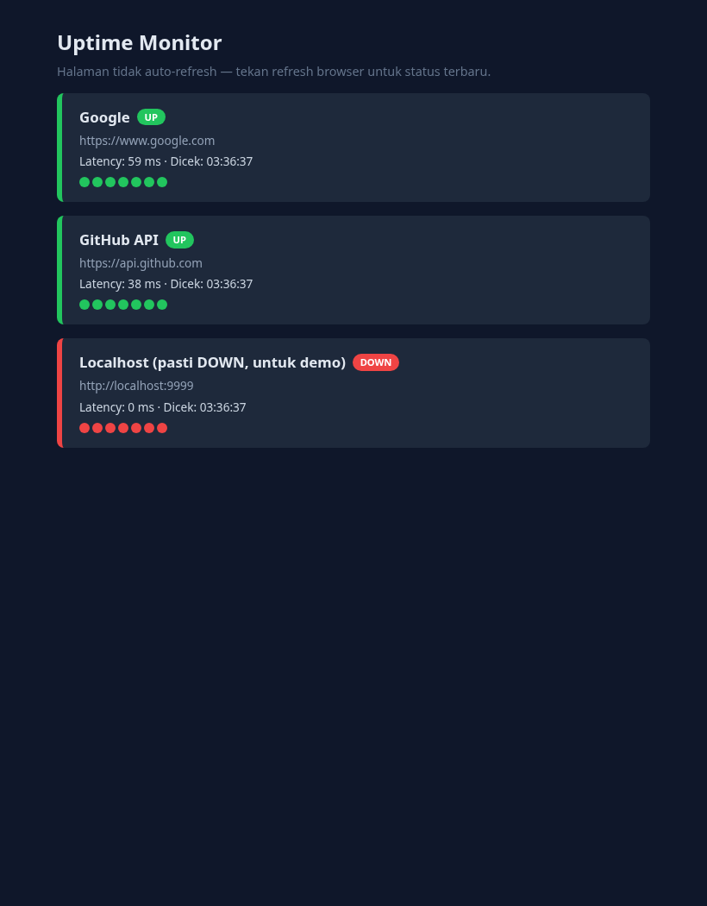

# Uptime Monitor

[](https://github.com/devyrix/Uptime-Monitor/actions/workflows/ci.yml)

Health checker kecil yang mengecek beberapa URL secara berkala dan menampilkan
status UP/DOWN, latensi, dan riwayat singkat di dashboard web.
Dibuat dengan Go + Fiber sebagai projek belajar DevOps.



## Fitur

- Cek periodik tiap target (goroutine per target, interval bisa diatur)
- Dashboard HTML: badge UP/DOWN, latensi, riwayat titik hijau/merah
- API JSON `GET /api/status` untuk dikonsumsi tool lain
- Endpoint kesehatan diri `GET /healthz`
- Graceful shutdown (SIGINT/SIGTERM)
- Image Docker multi-stage ± 41 MB

## Jalankan (tanpa Docker)

```bash
go run .
# buka http://localhost:3000
```

## Jalankan (Docker)

```bash
docker compose up --build
# buka http://localhost:3000
```

## Konfigurasi (`targets.yaml`)

| Kunci      | Bawaan | Keterangan                           |
| ---------- | ------ | ------------------------------------ |
| `interval` | `30s`  | Jeda antar pengecekan per target     |
| `timeout`  | `5s`   | Timeout tiap HTTP request            |
| `history`  | `20`   | Jumlah hasil terakhir per target     |
| `targets`  | —      | Wajib. Minimal 1 target dengan `url` |

Path config alternatif: `go run . file-lain.yaml`.

## API

| Endpoint          | Keterangan                 |
| ----------------- | -------------------------- |
| `GET /`           | Dashboard HTML             |
| `GET /api/status` | Status semua target (JSON) |
| `GET /healthz`    | `200` + `ok`               |

## Batasan (disengaja)

Riwayat disimpan di memori — kosong lagi saat restart. Roadmap v2: persistensi SQLite,
alerting Telegram, endpoint `/metrics` Prometheus.

## Struktur

```
main.go      entrypoint + routes Fiber
config.go    loader + validasi targets.yaml
store.go     store in-memory (mutex, sliding window)
checker.go   goroutine polling + http.Client timeout
```
